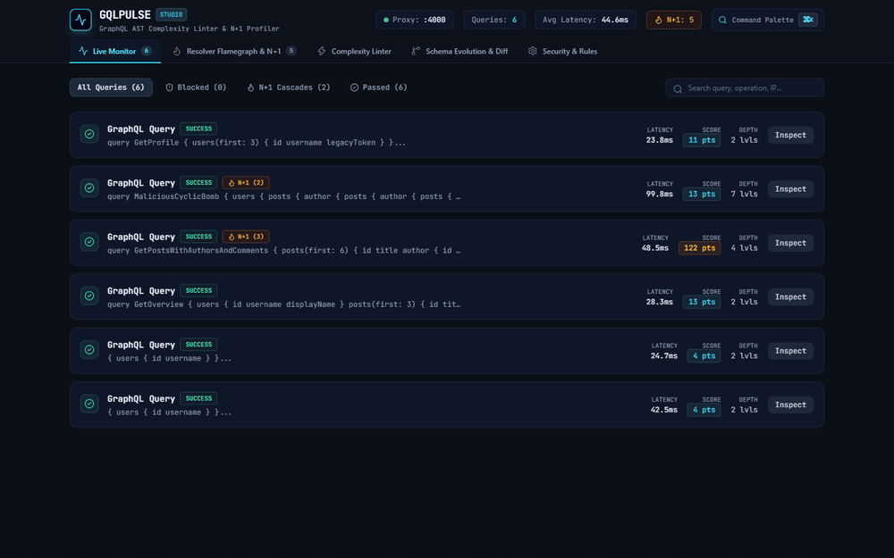
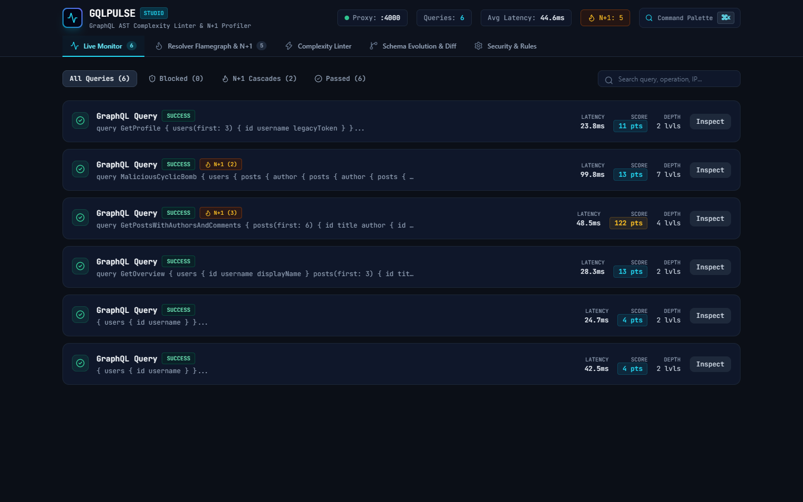
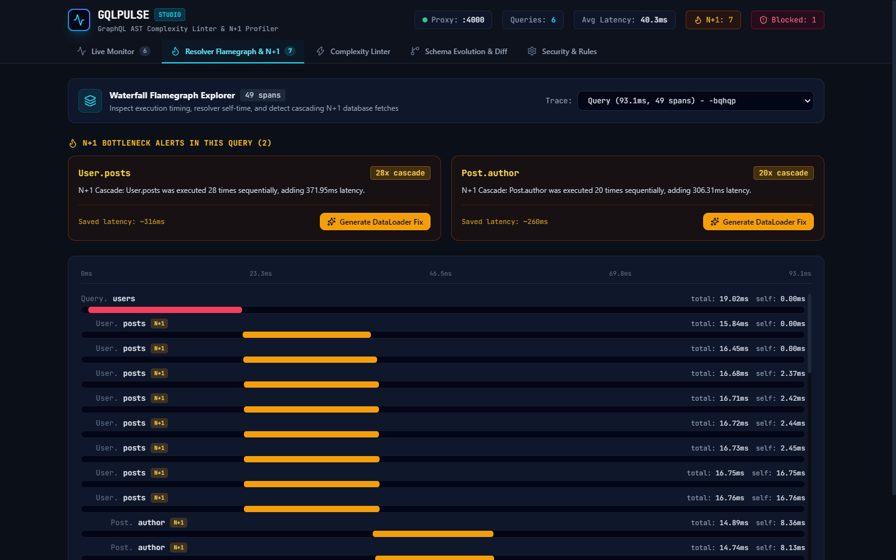
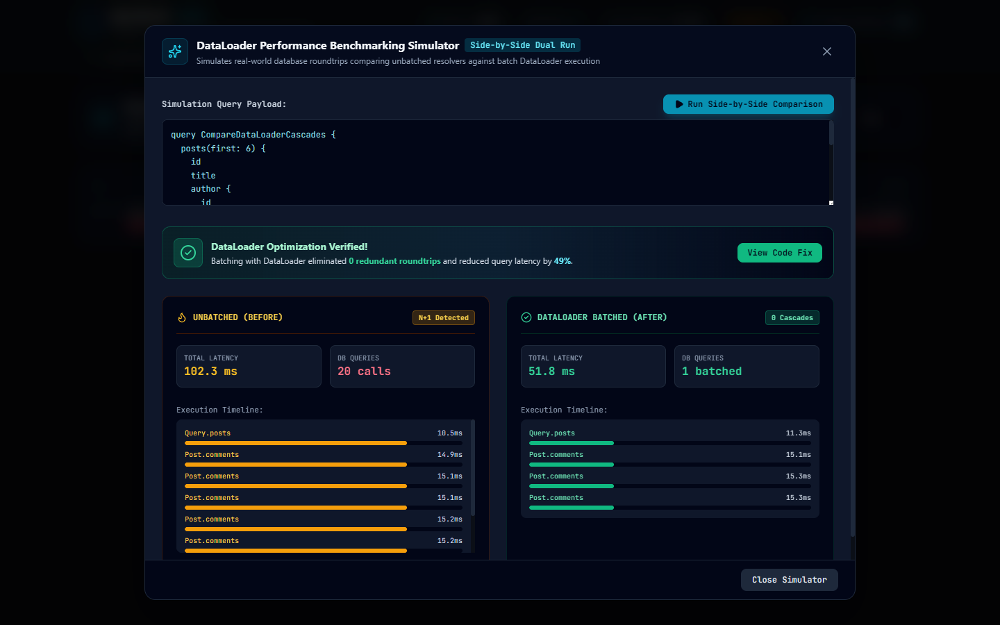
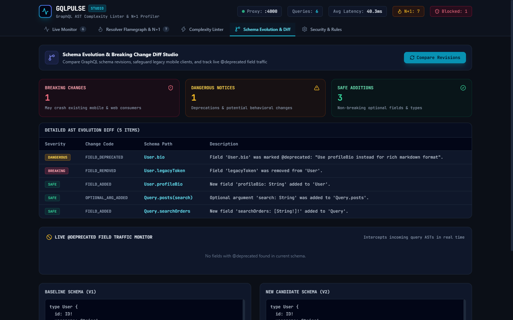
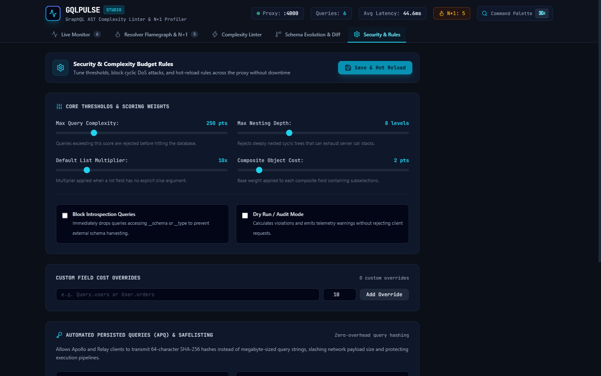
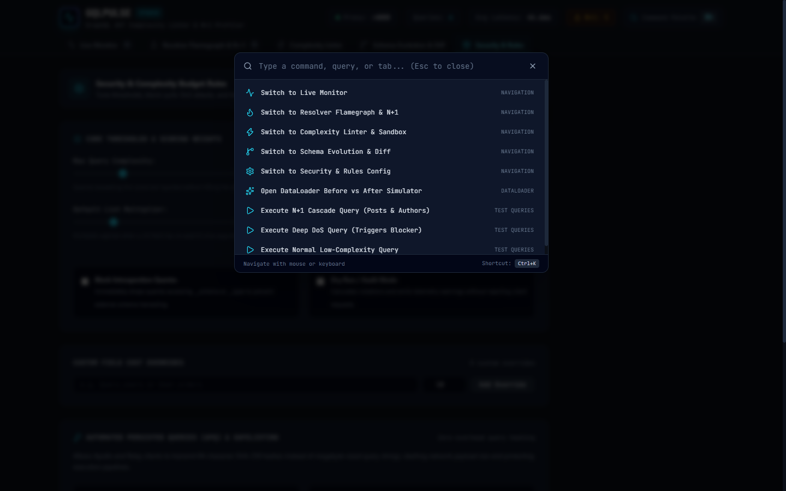
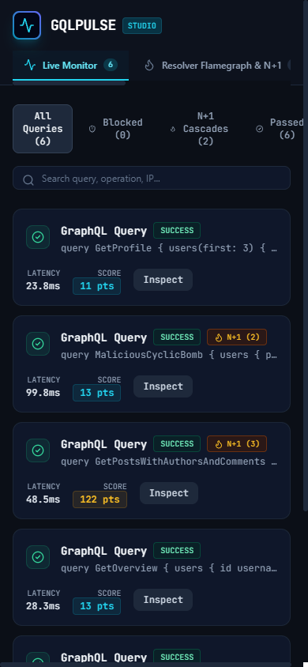

<p align="center">
  
</p>

<h1 align="center">GQLPulse</h1>

<p align="center">
  <strong>Real-Time GraphQL Query Complexity Linter, Resolver N+1 Profiler &amp; Schema Evolution Studio</strong>
</p>

<p align="center">
  <a href="LICENSE"></a>
  <a href="https://nodejs.org/"></a>
  <a href="https://www.typescriptlang.org/"></a>
  <a href="https://graphql.org/"></a>
  <a href="https://react.dev/"></a>
</p>

---

<p align="center">
  
</p>

---

## Overview

Engineering teams running GraphQL backends (Apollo Server, GraphQL Yoga, NestJS, Mercurius) routinely encounter two severe reliability bottlenecks:

1. **GraphQL Denial of Service (DoS)**: Unbounded client queries with deep recursion (such as `user -> posts -> comments -> author -> posts`) that lock up node event loops and exhaust memory before reaching the database.
2. **Hidden N+1 Resolver Cascades**: Nested resolvers executing dozens or hundreds of sequential database roundtrips due to missing or misconfigured DataLoader batching.

**GQLPulse** resolves both issues by deploying as a transparent reverse proxy and developer studio. It parses and validates incoming GraphQL ASTs in less than 0.5 milliseconds, rejects abusive queries before database execution, measures resolver execution waterfalls, flags N+1 cascades, verifies DataLoader performance improvements side by side, and tracks schema breaking changes in real time.

---

## Core Capabilities

- **Pre-Execution Query Linter (<0.5ms)**: Intercepts queries prior to execution. Computes AST node counts, tree depth, and cumulative complexity weights incorporating pagination arguments (`first`, `limit`, `last`).
- **Cyclic Recursion Blocker**: Traverses graph branches to detect and terminate circular reference attacks before downstream servers are touched.
- **Resolver Waterfall Flamegraphs**: Extracts execution timings across resolver hierarchies, separates self-time from child durations, and flags bottlenecks.
- **Automated Persisted Queries (APQ)**: Full Apollo APQ protocol support with SHA-256 caching and Strict Safelist mode to prevent ad-hoc arbitrary query execution.
- **Dual DataLoader Simulator**: Side-by-side benchmarking modal comparing unbatched resolvers against batch DataLoader execution, displaying exact latency and database roundtrip reductions.
- **Sensitive Field Masking**: Zero-dependency response payload masking supporting `REDACT`, `PARTIAL_EMAIL`, `HASH`, and `NULL` strategies for PII and auth tokens.
- **Production Prometheus Exporter**: Native `/metrics` endpoint exposing query totals, rejection rates, N+1 counts, and latency percentiles for Prometheus and Grafana.
- **Client Traffic Impact Analysis**: Schema diffing correlated with real query telemetry in proxy memory, identifying which client applications and operations are broken by proposed schema changes.
- **CI/CD PR Check Bot**: CLI `check` command generating formatted GitHub Actions markdown tables with severity alerts for pull requests.
- **Command Palette & Hotkeys**: Instant navigation and query execution via `Ctrl+K` or `Cmd+K`.

---

## Studio Interface

### 1. Live Traffic Monitor
The real-time monitor streams query throughput, status codes, complexity scores, depth gauges, and N+1 alerts over Server-Sent Events (SSE).

<p align="center">
  
</p>

### 2. Resolver Execution Waterfall & Flamegraph
Drill down into individual queries to inspect resolver offsets, self-time distributions, and identify cascading database calls.

<p align="center">
  
</p>

### 3. Dual DataLoader Performance Simulator
Compare unbatched resolver execution against batched DataLoader fetching side by side. Displays latency reduction percentages and database roundtrips saved.

<p align="center">
  
</p>

### 4. Schema Evolution & Client Traffic Impact
Compare baseline and candidate schema revisions to verify backward compatibility. Cross-references proposed breaking changes with real query telemetry to identify affected clients.

<p align="center">
  
</p>

### 5. Security & Hot-Reload Rules Config
Configure maximum complexity budgets, nesting depths, APQ strict safelists, and sensitive field masking rules with zero-downtime hot reloading.

<p align="center">
  
</p>

### 6. Command Palette
Press `Ctrl+K` or `Cmd+K` anywhere in the studio to switch tabs, trigger test queries, or run simulations.

<p align="center">
  
</p>

### 7. Mobile & Responsive Layout
The studio adapts dynamically to handheld devices, tablets, and wide monitors with fluid touch navigation and collapsable telemetry drawers.

<p align="center">
  
</p>

---

## Quickstart

### 1. Installation

Install globally or within your project monorepo:

```bash
git clone https://github.com/alexandrmotologa/gqlpulse.git
cd gqlpulse
npm install
npm run build
```

### 2. Run the Full-Stack Demo

Start both the sample GraphQL backend (port 4001) and the GQLPulse proxy with the web studio (port 4000):

```bash
npm run demo
```

Once running:
- Open the Studio dashboard: `http://localhost:4000/studio`
- Send client queries to: `http://localhost:4000/graphql`
- Target backend runs at: `http://localhost:4001/graphql`
- Prometheus metrics available at: `http://localhost:4000/metrics`

---

## CLI Usage

### Start Reverse Proxy
Forward traffic to an existing GraphQL backend while serving the studio:

```bash
npx gqlpulse proxy \
  --target http://localhost:4001/graphql \
  --port 4000 \
  --schema ./schema.graphql \
  --max-complexity 250 \
  --max-depth 8
```

### CI/CD Pull Request Schema Check
Verify schema compatibility during GitHub Actions builds. Outputs formatted markdown comments:

```bash
npx gqlpulse check ./candidate-schema.graphql \
  --against ./main-schema.graphql \
  --github-comment
```

### Lint a Query in CI/CD
Evaluate query complexity from the command line or during automated builds:

```bash
# Returns exit code 0 if approved, 1 if limits are exceeded
npx gqlpulse lint "query { users(first: 50) { posts { comments { text } } } }" \
  --schema ./schema.graphql \
  --max-complexity 200 \
  --max-depth 5
```

### Diff Schema Revisions
Catch breaking schema changes before deploying new API revisions:

```bash
npx gqlpulse diff ./schema-v1.graphql ./schema-v2.graphql
```

---

## Programmatic Integration

### Core Complexity Calculation

```typescript
import { QueryComplexityCalculator } from '@gqlpulse/core';
import { buildSchema } from 'graphql';

const schema = buildSchema(`...`);
const calculator = new QueryComplexityCalculator({
  maxComplexity: 250,
  maxDepth: 10,
  defaultListMultiplier: 10,
  scalarCost: 1,
  objectCost: 2,
}, schema);

const result = calculator.analyze(`
  query GetUsers {
    users(first: 10) {
      id
      displayName
      posts(limit: 5) {
        title
      }
    }
  }
`);

console.log(result.complexity);   // Computed score
console.log(result.depth);        // Max nesting levels
console.log(result.isBlocked);    // Boolean enforcement flag
console.log(result.durationMs);   // Linter parse duration in ms
```

### Response Field Masking

```typescript
import { ResponseDataMasker } from '@gqlpulse/core';

const masker = new ResponseDataMasker([
  { fieldPattern: 'legacyToken', strategy: 'REDACT' },
  { fieldPattern: 'email', strategy: 'PARTIAL_EMAIL' },
]);

const cleanPayload = masker.mask(upstreamData);
```

### Schema Traffic Impact Analysis

```typescript
import { SchemaDiffEngine, SchemaImpactAnalyzer } from '@gqlpulse/core';

const diffEngine = new SchemaDiffEngine();
const diffResult = diffEngine.diff(schemaV1, schemaV2);

const impactAnalyzer = new SchemaImpactAnalyzer();
const clientImpacts = impactAnalyzer.analyzeImpact(diffResult.items, recordedQueries);
```

---

## Complexity Scoring Methodology

GQLPulse calculates query complexity through deterministic AST traversal:

$$\text{Field Cost} = \text{Base Cost} \times \prod \text{Parent Multipliers}$$

1. **Leaf Scalars**: 1 point by default.
2. **Composite Objects**: 2 points by default.
3. **List Slicing**: Arguments (`first`, `limit`, `take`, `count`) multiply descendant field weights.
4. **Unpaginated Lists**: Fall back to the default list multiplier (10x).
5. **Directives**: Specific weights can be assigned via `@complexity(value: 50)` directives in the schema.

---

## Project Structure

```
gqlpulse/
├── packages/
│   ├── core/         # AST visitor, complexity calculator, profiler, diff engine, masking, impact
│   ├── proxy/        # Node.js HTTP reverse proxy, APQ engine, rate limiter, Prometheus metrics
│   ├── studio/       # React 19 + Tailwind CSS developer studio with flamegraphs and simulator
│   ├── demo-server/  # GraphQL API with intentional N+1 fixtures and deprecation fields
│   └── cli/          # Command-line binary for proxy, lint, diff, check, and demo
├── docs/
│   ├── images/       # Authentic UI screenshots and animated demo GIF
│   ├── ARCHITECTURE.md
│   ├── BENCHMARKS.md
│   └── DATALOADER_GUIDE.md
└── package.json
```

---

## Documentation

- [Technical Architecture](docs/ARCHITECTURE.md)
- [Performance Benchmarks](docs/BENCHMARKS.md)
- [DataLoader Implementation Guide](docs/DATALOADER_GUIDE.md)

---

## License

This project is licensed under the [MIT License](LICENSE).
